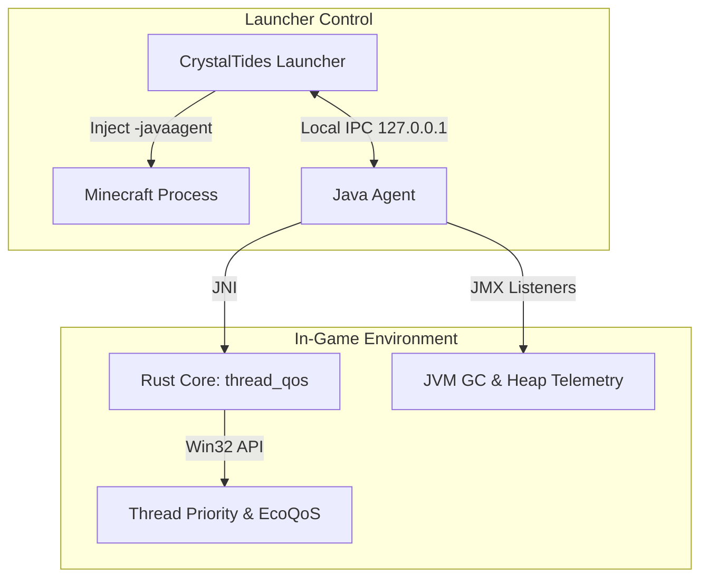

# 🌉 CrystalTides Game Bridge

> **The native heart of the player's client.**


## 💎 Overview

El **CrystalTides Game Bridge** (o Game Agent) es un componente cliente experimental diseñado para integraciones nativas profundas. A diferencia del bridge del servidor, este agente vive dentro del proceso de Minecraft del jugador, permitiendo capacidades que van más allá de lo que un mod estándar puede ofrecer.

---

## 🌟 Core Features

- 🔌 **Asynchronous Local IPC**: Cliente de socket asíncrono en hilo dedicado restringido a `127.0.0.1`, con cola que descarta ante saturación y handshake con token de sesión.
- 📊 **Non-Intrusive GC & Heap Telemetry**: Listener JMX de notificaciones para medir pausas de GC sin asignaciones periódicas y reporte de memoria heap (usada y máxima).
- ⚡ **Thread QoS & Windows EcoQoS Bypass**: Ajuste nativo de prioridad de hilo en Windows (hasta `THREAD_PRIORITY_ABOVE_NORMAL`) y desactivación de EcoQoS (Power Throttling) vía Win32 `SetThreadInformation`.
- 🎮 **Game Lifecycle Notification**: Señalización de `notifyGameReady` para notificar al launcher cuando el menú principal del juego está listo.

---

## 🏗️ Architecture

El Game Bridge opera como un puente entre el launcher local y el runtime de Java de Minecraft:



> [!NOTE]
> **Estado de Desarrollo**: Este es un componente **experimental**. No es obligatorio para entrar al servidor, pero habilita características de telemetría y optimización en el launcher oficial.

---

## 🛠️ Tech Stack

| Componente     | Tecnología                        | Propósito                                        |
| :------------- | :-------------------------------- | :----------------------------------------------- |
| **Injection**  | Java Instrumentation API          | Enganche en el arranque de la JVM (`-javaagent`) |
| **Local IPC**  | Java Sockets (`127.0.0.1`)        | Telemetría y señalización hacia el Launcher      |
| **Telemetry**  | Java Management API (JMX)         | Monitoreo no intrusivo de pausas de GC y heap    |
| **Thread QoS** | [Rust](https://www.rust-lang.org) | Win32 Thread Priority y desactivación de EcoQoS  |

---

## 🚀 Desarrollo & Build

### 🛠️ Entorno Local

1.  **Instalar dependencias nativas:**
    Asegúrate de tener `cargo` (Rust) y un `JDK 17+` instalado.
2.  **Compilar el puente:**
    ```bash
    npm run build
    ```
    _Este comando orquesta la compilación del binario en Rust y el empaquetado del JAR del agente._

---

> [!WARNING]
> **Uso avanzado**: La inyección de agentes Java puede ser detectada por algunos anti-cheats externos. Este componente está diseñado para ser usado exclusivamente dentro del ecosistema **CrystalTides**.

---

> [!NOTE]
> Este repositorio forma parte del monorepo de **CrystalTides**. Para más información sobre el ecosistema completo, visita el [README Principal](../../projects/README.md).
