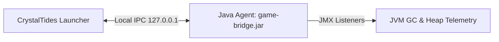

# 🌉 CrystalTides Game Bridge

Agente Java (`-javaagent`) que se ejecuta dentro del proceso de Minecraft del cliente para proporcionar comunicación IPC local y telemetría de runtime hacia el launcher de CrystalTides.

---

## 🌟 Características Principales

- 🔌 **Asynchronous Local IPC**: Cliente de socket asíncrono en hilo dedicado restringido a `127.0.0.1`, con cola no bloqueante que descarta payloads ante saturación y handshake de autenticación con token de sesión.
- 📊 **GC & Heap Telemetry**: Listener JMX (`GarbageCollectorMXBean`) de notificaciones para registrar pausas de GC sin asignaciones periódicas, junto con muestreo periódico (1 Hz) de memoria heap utilizada y máxima (`MemoryMXBean`).

---

## 🎮 Ciclo de Vida y Señal `game_ready`

> [!NOTE]
> El método `CrystalAgent.notifyGameReady()` está implementado como punto de extensión público para cuando el cliente complete su carga inicial (por ejemplo, mediante un mod o mixin de Minecraft).
> Actualmente **no se emite de forma automática** (no se utilizan temporizadores artificiales en el agente). El launcher no se bloquea en espera de este mensaje y gestiona el ciclo de vida del juego de manera desacoplada.

---

## 🏗️ Arquitectura



---

## 🛠️ Stack Tecnológico

| Componente    | Tecnología                 | Propósito                                         |
| :------------ | :------------------------- | :------------------------------------------------ |
| **Injection** | Java Instrumentation API   | Inyección en el arranque de la JVM (`-javaagent`) |
| **Local IPC** | Java Sockets (`127.0.0.1`) | Telemetría y señalización hacia el Launcher       |
| **Telemetry** | Java Management API (JMX)  | Monitoreo no intrusivo de pausas de GC y heap     |

---

## 🚀 Compilación

Requiere `JDK 17+` y `Maven 3.8+`.

```bash
cd java-agent
mvn clean package
```

El artefacto resultante se genera en `java-agent/target/game-bridge-1.0-SNAPSHOT.jar`.
