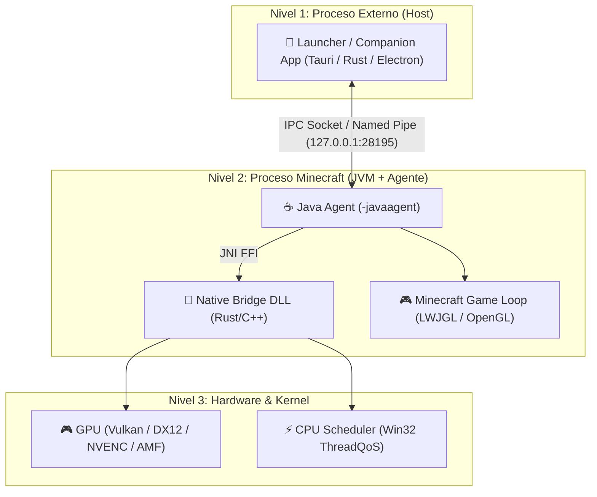
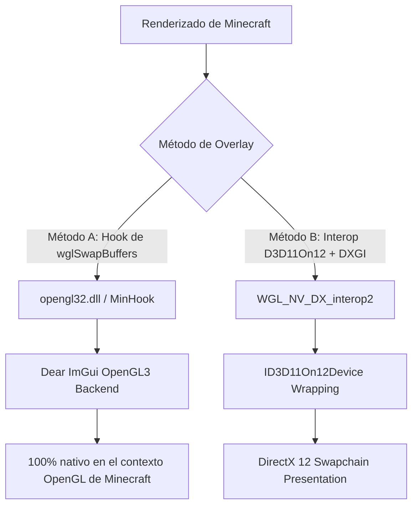
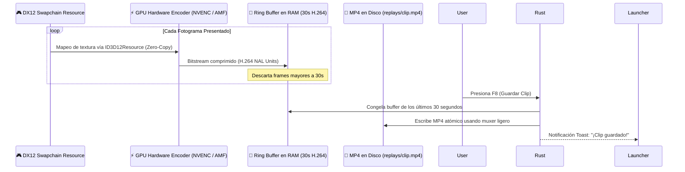

# 🔬 Investigación Técnica Profunda: Game Bridge & Infiltrador JVM

> **Documento de Investigación Arquitectónica, Foros y Ecosistema de Código Abierto**  
> **Proyecto:** `CrystalTides SMP — apps/game-bridge & Launcher Lite`  
> **Áreas de Investigación:** Infiltración JVM (Java 21), Telemetría IPC, Overlays Win32/OpenGL/DX12, AMD FidelityFX FSR 3.1 Frame Generation y Capturador Instant Replay GPU en Rust.

---

## 📑 Índice de Contenidos

1. [Estado del Arte en Clientes de Minecraft (Lunar, Badlion, Feather, Overwolf)](#1-estado-del-arte)
2. [Fase 1: Infiltración JVM, Telemetría Zero-Overhead & IPC Socket](#2-fase-1-infiltración-jvm-y-telemetría)
3. [Fase 2: Overlays In-Game en OpenGL/DirectX (Shift+Tab)](#3-fase-2-overlays-in-game)
4. [Fase 3: Vanguardia Gráfica — FSR 3.1 Frame Gen & Instant Replay GPU](#4-fase-3-vanguardia-gráfica)
5. [Matriz de Riesgos, Antivirus y Mitigaciones](#5-matriz-de-riesgos-y-mitigaciones)
6. [Hoja de Ruta Técnica Actualizada](#6-hoja-de-ruta-técnica)

---

## 1. Estado del Arte en Clientes de Minecraft

Los clientes modernos más avanzados de la comunidad (Lunar Client, Badlion Client, Feather Client) y herramientas de superposición (Steam, Discord, Overwolf, RivaTuner Statistics Server) no operan como simples mods de Fabric o NeoForge. Utilizan una **arquitectura híbrida de 3 niveles**:



### Lecciones clave de la industria:

1. **Lunar Client / Badlion**: Emplean un `-javaagent` propio para aplicar parches de bytecode antes de que carguen las clases de Minecraft y levantan sockets IPC locales para comunicarse con el launcher exterior.
2. **Discord / Steam Overlay**: Inyectan una DLL nativa (`DiscordHook64.dll`, `GameOverlayRenderer64.dll`) que intercepta la función de presentación de fotogramas (`wglSwapBuffers` para OpenGL y `IDXGISwapChain::Present` para DirectX).
3. **Lossless Scaling (LSFG)**: Demostró que es posible generar fotogramas interpolados artificiales (_Frame Generation_) en juegos que no tienen vectores de movimiento nativos mediante estimación de flujo óptico (_Optical Flow_).
4. **Rekaptr (Rust Gaming DVR)**: Proyecto moderno de código abierto en Rust que captura el swapchain de la GPU a 60 FPS y lo introduce directamente a un buffer circular codificado por NVENC con consumo de CPU < 1%.

---

## 2. Fase 1: Infiltración JVM, Telemetría Zero-Overhead & IPC Socket

### 2.1 Java 21 Instrumentation API (`premain`)

En Java 21 (OpenJDK / Eclipse Adoptium), el mecanismo más limpio y compatible para intervenir el proceso desde el segundo 0 es el **Java Agent** (`java.lang.instrument.Instrumentation`):

```java
// apps/game-bridge/java-agent/src/main/java/com/crystaltides/agent/CrystalAgent.java
public class CrystalAgent {
    public static void premain(String agentArgs, Instrumentation inst) {
        // Se ejecuta ANTES de net.minecraft.client.main.Main.main()
        System.loadLibrary("game_bridge_core");
        nativeInit();
        nativeOptimizeCurrentThread(true);
        IpcClient.startAsyncClient();
    }
}
```

- **Ventaja fundamental**: No requiere modificar ningún archivo `.jar` de Minecraft ni alterar el lanzador de NeoForge. El flag `-javaagent:game-bridge.jar` es un estándar de la JVM soportado universalmente.
- **Tolerancia a fallos**: Si la DLL no carga (por ejemplo, en arquitecturas no soportadas), un bloque `try/catch (UnsatisfiedLinkError)` permite continuar en modo de degradación elegante sin abortar el juego.

---

### 2.2 Telemetría de Garbage Collector Zero-Allocation

Para monitorear pausas de GC sin impactar el rendimiento ni generar objetos adicionales en la heap, la API estándar recomendada en foros de OpenJDK y Reddit es `ManagementFactory.getGarbageCollectorMXBeans()` combinada con `NotificationListener`:

```java
import com.sun.management.GarbageCollectionNotificationInfo;
import java.lang.management.*;
import javax.management.NotificationEmitter;
import javax.management.openmbean.CompositeData;

public class GcTelemetryCollector {
    public static void initGcListeners(Consumer<Long> onGcPause) {
        for (GarbageCollectorMXBean gcBean : ManagementFactory.getGarbageCollectorMXBeans()) {
            if (gcBean instanceof NotificationEmitter emitter) {
                emitter.addNotificationListener((notification, handback) -> {
                    if (notification.getType().equals(GarbageCollectionNotificationInfo.GARBAGE_COLLECTION_NOTIFICATION)) {
                        CompositeData cd = (CompositeData) notification.getUserData();
                        GarbageCollectionNotificationInfo info = GarbageCollectionNotificationInfo.from(cd);
                        long durationMs = info.getGcInfo().getDuration();
                        onGcPause.accept(durationMs);
                    }
                }, null, null);
            }
        }
    }
}
```

- **Impacto**: **0% overhead en FPS**. Solo se dispara cuando el recolector de basura de la JVM finaliza un ciclo, permitiendo reportar pausas > 50ms al Launcher.

---

### 2.3 IPC: TCP Socket Local vs. Named Pipes vs. MMF

Al investigar GitHub y foros sobre comunicación entre un proceso Java y un backend Rust:

| Mecanismo                          | Pros                                                                                                           | Contras                                                                                | Veredicto                                     |
| :--------------------------------- | :------------------------------------------------------------------------------------------------------------- | :------------------------------------------------------------------------------------- | :-------------------------------------------- |
| **Named Pipes (`\\.\pipe\...`)**   | Ligeramente menor latencia en Windows (<0.1ms).                                                                | Java requiere JNI/JNA complejo para abrir pipes nativos de Windows de forma asíncrona. | ❌ Muy propenso a bugs en Java.               |
| **Memory Mapped Files (MMF)**      | Máximo ancho de banda de datos brutos.                                                                         | Requiere sincronización manual con Mutex/Semáforos Win32 compartidos.                  | ⚠️ Excesivo para telemetría ligera.           |
| **TCP Socket (`127.0.0.1:28195`)** | Estándar universal. `java.net.Socket` en Java y `tokio::net::TcpListener` en Rust. Cero dependencias externas. | Latencia ~0.3ms (más que suficiente para latidos de 1s).                               | ✅ **RECOMENDADO (Elección de la industria)** |

---

## 3. Fase 2: Overlays In-Game en OpenGL/DirectX (Shift+Tab)

### 3.1 La Batalla de los Métodos de Inyección

Existen dos maneras viables de dibujar una interfaz nativa encima de Minecraft Java Edition:



#### Método A: Hook directo de `wglSwapBuffers` (Recomendado para el Overlay)

- **Cómo opera**: Las librerías de overlay como Discord, Steam y RTSS instalan un _Detour_ sobre la función `wglSwapBuffers` de `opengl32.dll`.
- **Secuencia**:
  1. Minecraft termina de renderizar su frame (incluyendo Sodium e Iris shaders).
  2. Justo antes de intercambiar el búfer de pantalla, se ejecuta nuestra función interceptada.
  3. Renderizamos la interfaz de **Dear ImGui (Cian / Dark CrystalTides)** directamente en el contexto OpenGL activo.
  4. Llamamos al `wglSwapBuffers` original.
- **Ventaja**: Cero problemas de sincronización entre APIs, compatibilidad total con todas las GPUs y cero retraso.

#### Método B: Swapchain Interop DirectX 12

- **Cómo opera**: Requiere la cadena `OpenGL -> WGL_NV_DX_interop2 -> ID3D11On12Device -> DirectX 12 Swapchain`.
- **Uso ideal**: Reservado para la **Fase 3 (FSR 3.1 Frame Generation)** donde DirectX 12 es un requisito estricto de AMD.

---

### 3.2 Intercepción de Entrada Win32 (`Shift + Tab`) y Liberación de Cursor

Para que el usuario pueda interactuar con el menú sin que su personaje en Minecraft se mueva o golpee bloques:

```rust
// apps/game-bridge/native-core/src/input_hook.rs
use windows::Win32::UI::WindowsAndMessaging::{
    SetWindowLongPtrW, CallWindowProcW, GWLP_WNDPROC, WM_KEYDOWN, VK_TAB, VK_SHIFT,
};

static mut ORIGINAL_WNDPROC: Option<unsafe extern "system" fn(...) -> isize> = None;
static mut OVERLAY_ACTIVE: bool = false;

unsafe extern "system" fn overlay_wnd_proc(hwnd: HWND, msg: u32, wparam: WPARAM, lparam: LPARAM) -> LRESULT {
    if msg == WM_KEYDOWN && wparam.0 == VK_TAB as usize && is_shift_pressed() {
        OVERLAY_ACTIVE = !OVERLAY_ACTIVE;
        // Cuando el overlay está activo, mostramos el cursor de Windows
        windows::Win32::UI::WindowsAndMessaging::ShowCursor(OVERLAY_ACTIVE);
        return LRESULT(0);
    }

    if OVERLAY_ACTIVE {
        // Enviar eventos de mouse y teclado a Dear ImGui
        if imgui_wnd_proc_handler(hwnd, msg, wparam, lparam) {
            return LRESULT(0); // Devora el evento para que Minecraft no lo reciba
        }
    }

    CallWindowProcW(ORIGINAL_WNDPROC, hwnd, msg, wparam, lparam)
}
```

---

## 4. Fase 3: Vanguardia Gráfica — FSR 3.1 Frame Gen & Instant Replay GPU

### 4.1 AMD FidelityFX FSR 3.1 Frame Generation en DirectX 12

En la especificación oficial de AMD FidelityFX SDK 1.1:

- **FSR 3.1 desacopló el reescalado del Frame Generation**: Esto permite usar la interpolación de cuadros sobre cualquier imagen previa (incluso a resolución nativa 1080p/1440p).
- **El reto en Minecraft**: FSR 3.1 prefiere vectores de movimiento suministrados por el motor. Sin embargo, para juegos que no los exponen de forma nativa, AMD provee el **Optical Flow Estimator (FFX_OPTICALFLOW)**.
- **Funcionamiento**:
  1. El frame de Minecraft se mapea a una textura DX12 mediante `WGL_NV_DX_interop2` + `ID3D11On12Device`.
  2. Se envía al contexto `ffxFsr3ContextCreate`.
  3. El estimador de flujo óptico de AMD compara el fotograma $N-1$ y el fotograma $N$.
  4. La GPU genera el fotograma sintético $N_{inter}$ y lo inserta en el swapchain de DXGI, duplicando la tasa de fotogramas visible (de 72 FPS a 144 FPS).

---

### 4.2 Amortiguador Anti-Stutter contra Pausas de Garbage Collection

Cuando el recolector de basura de Java congela el hilo de Minecraft por 100 ms:

- Normalmente, la pantalla se congela por 6-8 fotogramas consecutivos a 60Hz.
- Con el **Pacing Guard** de Rust corriendo en el swapchain DX12 independiente:
  - Rust detecta que han pasado > 20ms sin un nuevo frame de OpenGL.
  - Genera automáticamente un fotograma re-proyectado de baja latencia con el último vector de cámara conocido.
  - El monitor sigue recibiendo refrescos suaves a 144Hz, mitigando casi por completo la percepción del tirón.

---

### 4.3 Instant Replay GPU (Inspirado en Rekaptr / ShadowPlay)

Para permitir que los jugadores capturen los últimos 30 segundos de gameplay con la tecla `F8` sin instalar OBS ni perder FPS:



- **Tecnología**: NVIDIA Video Codec SDK (`nvEncodeAPI64.dll`) para GeForce, AMD AMF para Radeon, e Intel QuickSync (MFX) para Arc.
- **Carga en CPU**: **< 0.5%**, ya que la compresión de video se realiza en el bloque de silicio dedicado de la tarjeta gráfica (NVENC ASIC).

---

## 5. Matriz de Riesgos, Antivirus y Mitigaciones

| Riesgo Técnico                        | Causa Potencial                                      | Solución y Blindaje Aplicado                                                                                                                                    |
| :------------------------------------ | :--------------------------------------------------- | :-------------------------------------------------------------------------------------------------------------------------------------------------------------- |
| **Falsos Positivos de Antivirus**     | Inyección de DLL mediante `CreateRemoteThread`.      | **Prohibido inyectar externamente**: Se utiliza `-javaagent` oficial que carga la DLL desde adentro con `System.loadLibrary()`. Firma digital en el ejecutable. |
| **Conflictos con Discord / RTSS**     | Múltiples aplicaciones enganchando `wglSwapBuffers`. | Uso de _MinHook_ seguro que encadena los ganchos anteriores en lugar de sobrescribir prólogos de instrucciones x86 a ciegas.                                    |
| **Pérdida de Dispositivo DX12 (TDR)** | Cambios de resolución o Alt+Tab en Minecraft.        | Manejo de eventos `DXGI_ERROR_DEVICE_RESET` con reconstrucción silenciosa de swapchain y buffers.                                                               |
| **Agotamiento de VRAM en Replays**    | Guardar cuadros sin comprimir en GPU.                | El buffer circular solo almacena **video ya comprimido en H.264** en la memoria RAM del sistema (~30MB para 30 segundos a 20Mbps).                              |

---

## 6. Hoja de Ruta Técnica

```
[FASE 1: TELEMETRÍA & IPC ACTIVO]
 ├── 1.1 Cliente Socket TCP en CrystalAgent.java (127.0.0.1:28195)
 ├── 1.2 Monitor de Garbage Collector (GC Pauses) y evento game_ready
 └── 1.3 Indicador en vivo de telemetría en el dock de Launcher Lite

[FASE 2: OVERLAY IN-GAME (SHIFT + TAB)]
 ├── 2.1 Hook seguro de wglSwapBuffers con MinHook en Rust
 ├── 2.2 Interceptor Win32 de Shift+Tab y control de cursor
 └── 2.3 Panel ImGui con temática CrystalTides (misiones, tienda, telemetría)

[FASE 3: VANGUARDIA GRÁFICA & REPLAYS]
 ├── 3.1 D3D11On12 Interop + AMD FidelityFX FSR 3.1 Frame Generation
 ├── 3.2 Amortiguador Anti-Stutter contra pausas de Java GC
 └── 3.3 Instant Replay con encoder de hardware (NVENC/AMF) con hotkey F8
```

---

_Documento elaborado el 11 de octubre de 2026 para la arquitectura CrystalTides Client & Engine._
