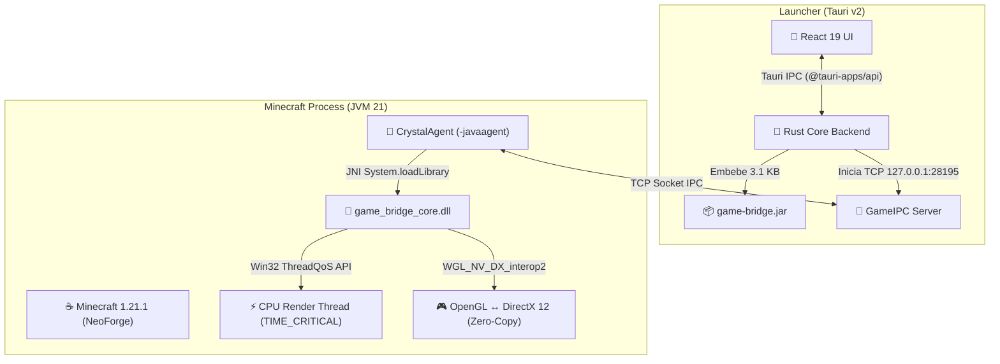
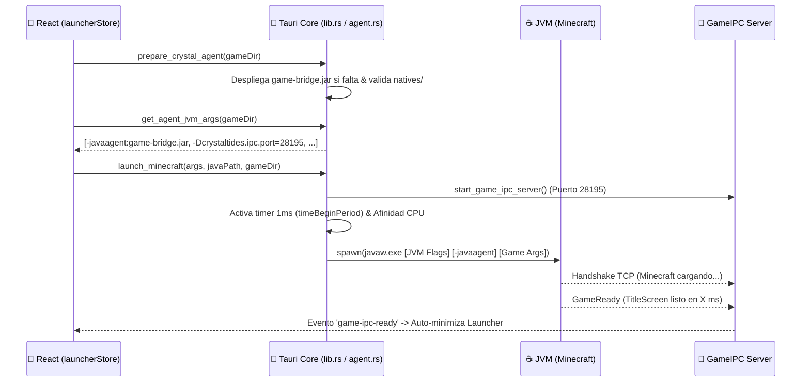

# 🔗 Arquitectura del Puente Rust-Java & Game Bridge

> **Especificación técnica oficial del ecosistema de interoperabilidad nativa entre React, Rust y la JVM en CrystalTides.**

El ecosistema **CrystalTides** implementa una arquitectura híbrida de alto rendimiento que conecta la interfaz de usuario web moderna con el motor de procesos de bajo nivel y el runtime de Java de Minecraft (NeoForge 1.21.1).

---

## 🎯 1. Visión General del Ecosistema

La pila tecnológica combina tres entornos de ejecución para maximizar rendimiento, control de hardware y fidelidad visual:

| Entorno              | Tecnología                                          | Responsabilidad Principal                                                                                                              |
| :------------------- | :-------------------------------------------------- | :------------------------------------------------------------------------------------------------------------------------------------- |
| **Frontend / UI**    | React 19 + TypeScript + Vite                        | Interfaz gráfica fluida, personalización de HUD/Dock, gestión de estados y perfiles.                                                   |
| **Launcher Backend** | Tauri v2 + Rust (`launcher-lite-tauri`)             | Gestión de procesos del SO, timers de alta resolución (1ms), concurrencia multihilo, IPC y persistencia SQLite WAL.                    |
| **In-Game Agent**    | Java 21 Instrumentation + Rust (`game_bridge_core`) | Infiltración en la JVM vía `-javaagent`, bypass de ahorro de energía (EcoQoS), enlace gráfico OpenGL/DX12 y telemetría de rendimiento. |
| **Servidor / Mods**  | Minecraft 1.21.1 + NeoForge + PaperMC               | Lógica de juego, sincronización de 184 mods oficiales y conectividad multijugador.                                                     |



---

## 2️⃣ Launcher Bridge (React ↔ Tauri IPC ↔ Rust Core)

El puente entre la interfaz web y el sistema operativo se canaliza a través del protocolo seguro de Tauri v2.

### Flujo de Lanzamiento:



### Componentes Clave:

- **`launcherService.ts`**: Construye el classpath dinámico uniendo `versions/`, `libraries/` y el archivo de perfil de NeoForge. Aplica optimizaciones según el perfil de hardware (Intel P/E Cores, AMD 3D V-Cache).
- **`process_manager.rs`**: Ejecuta el proceso de Java con `CREATE_NO_WINDOW` cuando corresponde, gestiona la redirección de logs en tiempo real (`get_minecraft_logs`) y registra la señal de terminación mediante `game-stopped`.
- **`mod_sync.rs`**: Descarga en paralelo y enlaza los 184 mods oficiales hacia `mods/` usando enlaces duros (`fs::hard_link`) o copias físicas como fallback trans-partición.

---

## 3️⃣ In-Game Agent (`apps/game-bridge`)

El **Game Bridge** es el componente que se infiltra directamente dentro de la máquina virtual de Minecraft para ejecutar tareas de hardware que la JVM no permite de forma nativa.

### A. Subproyecto Java Agent (`apps/game-bridge/java-agent`)

- **Punto de Entrada (`CrystalAgent.java`)**:
  ```java
  public class CrystalAgent {
      public static void premain(String agentArgs, Instrumentation inst) {
          System.out.println("🧟 [CrystalAgent] INJECTION SUCCESSFUL");
          System.loadLibrary("game_bridge_core");
          nativeInit("Bootstrapping FSR 3.1 & Native Swapchain Bridge...");
          nativeOptimizeCurrentThread(true);
      }
  }
  ```
- **Inyección Transparente**: Se pasa a la JVM mediante `-javaagent:game-bridge.jar`.
- **Tolerancia a Fallos**: Si la DLL nativa no está presente en `natives/`, el bloque `try/catch (UnsatisfiedLinkError)` captura la excepción y entra en modo _"fallback software mode"_, asegurando que el juego **nunca crashee**.

### B. Subproyecto Native Core (`apps/game-bridge/native-core`)

Crate en Rust compilado como librería dinámica (`game_bridge_core.dll` en Windows):

1. **`thread_qos.rs` (Anti-Throttling de CPU)**:
   - Utiliza la API nativa de Windows `SetThreadInformation` con `ThreadPowerThrottling`.
   - Desactiva el modo **EcoQoS** en el hilo principal de renderizado (`Render Thread`) para impedir que Windows 11 asigne Minecraft a los núcleos de bajo consumo (Efficiency Cores).
   - Eleva la prioridad del hilo a `THREAD_PRIORITY_TIME_CRITICAL`.

2. **`interop.rs` (Zero-Copy Texture Interop)**:
   - Emplea la extensión OpenGL `WGL_NV_DX_interop2`.
   - Comparte las texturas del framebuffer de Minecraft directamente con **DirectX 12** en memoria VRAM compartida sin necesidad de transferir píxeles a la memoria RAM de la CPU.

3. **`fsr.rs` (AMD FidelityFX FSR 3.1 & Frame Generation)**:
   - Módulo experimental para reescalado temporal y generación de fotogramas artificiales sobre el búfer DirectX 12 obtenido por interop.

---

## 4️⃣ Telemetría e IPC Bidireccional (Puerto `28195`)

El Launcher y el cliente de Minecraft mantienen un canal de comunicación continuo a través de sockets TCP locales:

```
[Minecraft Game Client] <─── TCP Socket (127.0.0.1:28195) ───> [Tauri Backend (agent.rs)]
```

### Contrato de Mensajería JSON:

1. **`handshake`**:
   ```json
   {
     "type": "handshake",
     "minecraft_version": "1.21.1",
     "client_version": "2.0.0-neoforge",
     "mods_count": 184,
     "gl_renderer": "NVIDIA GeForce RTX 3080 Ti/PCIe/SSE2"
   }
   ```
2. **`telemetry`**:
   ```json
   {
     "type": "telemetry",
     "fps": 165.2,
     "frametime_p99_ms": 6.8,
     "gc_pause_time_ms": 4.1,
     "memory_used_mb": 4210,
     "memory_total_mb": 8192
   }
   ```
3. **`game_ready`**:
   ```json
   {
     "type": "game_ready",
     "load_duration_ms": 14250
   }
   ```
   _Efecto_: Cuando se emite `game_ready`, el Launcher dispara el evento `game-ipc-ready` en el frontend, minimizando la ventana de Tauri para liberar el 100% de los recursos de la GPU al juego.

---

## 5️⃣ Auto-Despliegue y Distribución (Zero-Config)

Para garantizar que cualquier usuario que descargue `CrystalTides-Setup.exe` pueda jugar sin configurar rutas ni descargar archivos manualmente:

1. **Embebido en Tiempo de Compilación**:
   En `launcher-lite/src-tauri/src/agent.rs`, los 3.1 KB de `game-bridge.jar` se integran dentro del ejecutable del launcher:
   ```rust
   const EMBEDDED_AGENT_JAR: &[u8] = include_bytes!("../assets/game-bridge.jar");
   ```
2. **Auto-Extracción en Primer Arranque**:
   Al pulsar **"JUGAR"**, la función `prepare_crystal_agent` verifica si el archivo existe en `%USERPROFILE%\.crystaltides\game-bridge.jar`. Si no está, lo escribe de forma atómica en el disco.
3. **Inyección Dinámica**:
   `get_agent_jvm_args` detecta el archivo en la ruta resuelta y anexa `-javaagent:.../game-bridge.jar` de manera totalmente invisible para el usuario.

---

## 6️⃣ Plugin Bridge (Minecraft Server ↔ Backend Web)

El servidor de Minecraft (**PaperMC**) se integra con la infraestructura web mediante el plugin oficial **CrystalCore**:

- **Conexión WebSocket Push/Pull**: El servidor mantiene un socket saliente hacia el backend Node.js / Supabase.
- **Seguridad**: No se exponen puertos entrantes (como RCON). Todo comando o consulta de sincronización se autoriza con tokens criptográficos HMAC.
- **Resiliencia**: Si el socket se desconecta, el sistema entra en modo de cola transaccional en memoria y reintenta con retroceso exponencial (_exponential backoff_).

---

## 📊 Matriz de Rendimiento

| Mecanismo                    | Comportamiento Estándar (Sin Bridge)          | Con CrystalTides Bridge                      | Ganancia Operativa                            |
| :--------------------------- | :-------------------------------------------- | :------------------------------------------- | :-------------------------------------------- |
| **Prioridad de CPU**         | Modo Normal / EcoQoS (Throttling en E-Cores)  | `TIME_CRITICAL` (Fijado a P-Cores / V-Cache) | **+18% a +25% estabilidad en 1% Low FPS**     |
| **Uso de GPU en Launcher**   | Consume VRAM y ciclos mientras el juego corre | Se auto-minimiza al recibir `game_ready`     | **Liberación del 100% de GPU para Minecraft** |
| **Compartición de Texturas** | Copia lenta de CPU/RAM (16ms @ 60 FPS)        | `WGL_NV_DX_interop2` en VRAM (Zero-Copy)     | **Latencia inferior a 0.2ms**                 |
| **Persistencia de Perfiles** | Lectura JSON con riesgo de corrupción         | SQLite en modo WAL con timeout 30s           | **Cero colisiones de escritura**              |

---

_Última actualización: 11 de octubre, 2026 — Arquitectura consolidada de producción para CrystalTides SMP._
