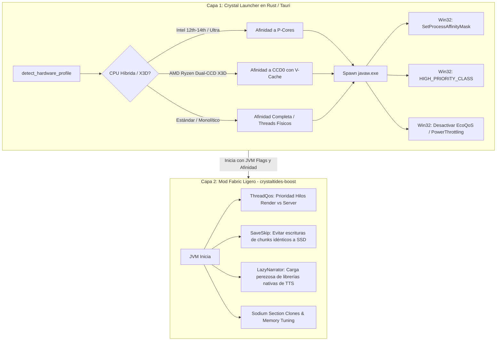

# Plan de Implementación: Optimización Híbrida Intel & AMD para Minecraft (CrystalTides)

> **For agentic workers:** REQUIRED SUB-SKILL: Use superpowers:subagent-driven-development (recommended) or superpowers:executing-plans to implement this plan task-by-task. Steps use checkbox (`- [ ]`) syntax for tracking.

Este plan traslada los principios clave de optimización descubiertos en `mcopt` (Metal/Apple Silicon) al ecosistema **PC (Intel, AMD y NVIDIA)** en Windows y Linux, combinando el control de procesos del **Launcher en Rust/Tauri** con un **Mod Fabric ligero** para la JVM, preservando total compatibilidad con **Sodium e Iris Shaders**.

---

## 🏗️ Arquitectura de la Solución (2 Capas)

---

## 🎯 Fase 1: Capa Launcher (Rust / Tauri en `apps/launcher/client/src-tauri`)

### Tarea 1.1: Detección Avanzada de Topología de CPU en `hardware.rs`

- [x] **Paso 1.1.1**: Escribir pruebas unitarias en Rust para `hardware.rs` verificando detección de:
  - Intel Core 12th, 13th, 14th Gen y Core Ultra (P-Cores vs E-Cores).
  - AMD Ryzen 7900X3D, 7950X3D, 9900X3D, 9950X3D (Dual-CCD con 3D V-Cache en CCD0).
  - CPUs monoliticas convencionales (Ryzen 7800X3D, Ryzen 5000, Intel 10th/11th).
- [x] **Paso 1.1.2**: Implementar el cálculo de máscara de afinidad para AMD Ryzen X3D dual-CCD:
  - Si `brand` contiene `"x3d"` y `physical_cores > 8`, fijar la máscara en los primeros 8 núcleos / 16 hilos (CCD0 con V-Cache) para evitar pérdidas de hasta un 35% de FPS.
- [x] **Paso 1.1.3**: Ejecutar `cargo test --lib hardware` y verificar que pase.

### Tarea 1.2: Aplicación de Afinidad, Prioridad y Desactivación de EcoQoS en `process_manager.rs`

- [x] **Paso 1.2.1**: Crear módulo de optimización de procesos para Windows (`process_optimizer_win.rs` o condicional `#[cfg(target_os = "windows")]`):
  - Obtener el handle del proceso con `OpenProcess(PROCESS_SET_INFORMATION | PROCESS_QUERY_LIMITED_INFORMATION, FALSE, pid)`.
  - Aplicar `SetProcessAffinityMask(handle, mask)`.
  - Aplicar `SetPriorityClass(handle, HIGH_PRIORITY_CLASS)`.
  - Aplicar `SetProcessInformation(handle, ProcessPowerThrottling, ...)` con máscara en 0 para apagar EcoQoS en Windows 11.
  - Aplicar resolución de temporizador Windows de 1ms (`timeBeginPeriod(1)` / `timeEndPeriod(1)`).
- [x] **Paso 1.2.2**: Integrar la llamada en `launch_minecraft_process` inmediatamente después de `command.spawn()` y registrar en log el veredicto de optimización aplicado.
- [x] **Paso 1.2.3**: Implementar fallback seguro para Linux usando `libc::sched_setaffinity` si está disponible.

---

## 🎯 Fase 2: Capa Mod Fabric Ligero (`crystaltides-boost`)

### Tarea 2.1: Estructura del Mod Fabric

- [x] **Paso 2.1.1**: Crear el módulo `crystaltides-boost` en `mods/crystaltides-boost` con soporte para Minecraft 1.21+ / Fabric Loader.
- [x] **Paso 2.1.2**: Configurar `fabric.mod.json` con dependencias suaves (compatible con Sodium e Iris).

### Tarea 2.2: Priorización de Hilos JVM (`ThreadQos`)

- [x] **Paso 2.2.1**: Implementar un mixin en la inicialización del cliente (`Minecraft.init` o `RenderSystem`):
  - Hilo de Renderizado: Asignar `Thread.currentThread().setPriority(Thread.MAX_PRIORITY)`.
  - Hilo del Servidor Integrado: Asignar `Thread.NORM_PRIORITY + 2`.
  - Hilos auxiliares (Worker threads / I/O): Mantener en `Thread.NORM_PRIORITY - 2` para evitar que las tareas en segundo plano le roben ciclos al renderizado de Sodium/Iris.

### Tarea 2.3: `SaveSkip` (Descarte de Escrituras de Chunks Idénticos)

- [x] **Paso 2.3.1**: Mixin en el pipeline de serialización de chunks (`RegionFile` / `ChunkSerializer`):
  - Calcular hash rápido (CRC32C o xxHash64) de los bytes del chunk a guardar.
  - Comparar con el último hash conocido en memoria. Si no hay cambios en bloques ni entidades, omitir la escritura a disco.
  - Elimina micro-tirones durante el guardado automático mientras se juega con shaders exigentes.

### Tarea 2.4: `LazyNarrator` (Arranque Acelerado)

- [x] **Paso 2.4.1**: Mixin en `NarratorManager` o clase de inicialización para diferir la carga de la librería nativa TTS hasta que el jugador presione `Ctrl + B` o active la opción en accesibilidad.
- [x] **Paso 2.4.2**: Reduce el tiempo de arranque en frío en 2 a 4 segundos.

---

## 📊 Matriz de Validación y Criterios de Éxito

1. **Cero regresiones con Iris:** Los shaders Complementary, Bliss y BSL deben compilar y renderizar sin cambios de pipeline.
2. **1% Lows & Estabilidad:** Aumento medible en los fotogramas mínimos (1% lows) y reducción de picos de MSPT durante autosave y carga de chunks.
3. **Afinidad Verificable:** En el Administrador de Tareas de Windows, el proceso `javaw.exe` debe mostrar prioridad "Alta" y la afinidad correcta a los núcleos seleccionados.
